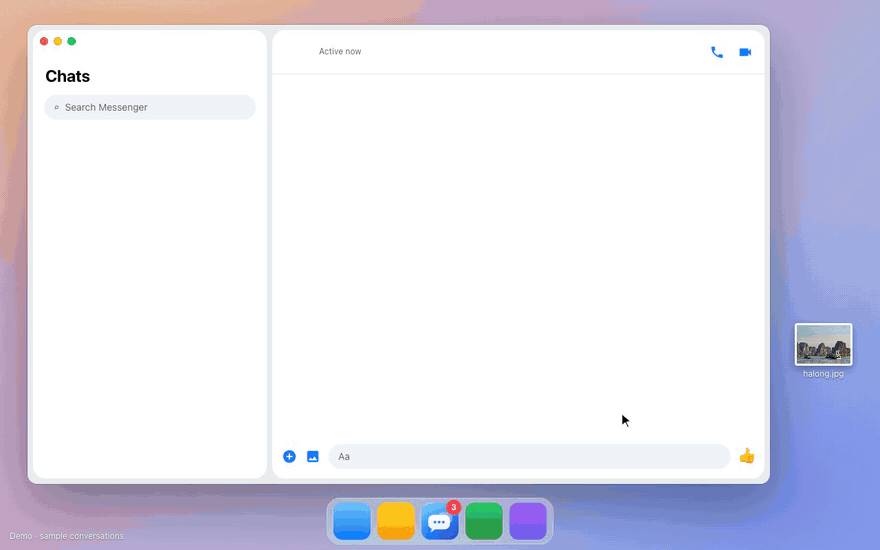

<div align="center">


# Natter

**An unofficial desktop app for Facebook Messenger** — on macOS, Windows and Linux.

Meta shut down the Messenger desktop app in December 2025. Natter brings back a calm, chat-only window:
no feed, no notifications from the rest of Facebook, just your conversations.

[](LICENSE)


[](CONTRIBUTING.md)



<sub>Demo with sample conversations.</sub>

</div>

## Why Natter

- **Chat only.** Chats, their media viewer and sign-in. Profiles, posts and every other link open in your browser.
- **Feels like a desktop app.** Full-height panes, no page scrollbars or Facebook header. On macOS the title bar blends in and the panes float like macOS 26 apps (optional glass window).
- **Calls work**, including in end-to-end encrypted chats (Natter build).
- **Unread badge** on the Dock / taskbar and in the menu bar / tray, counting unread conversations.
- **Notifications** with Do not disturb, hidden previews and sound options.
- **Themes:** follow Facebook, or force System, Light, Grey, true-black Dark or High contrast — without a reload.
- **Files:** attach, drag in or paste photos and files; downloads go to your Downloads folder.
- **Lives in the menu bar / tray** if you want it to, opens at login, single instance.
- **Light:** no work while you scroll or type; the Lite build is about 10 MB.

## Natter or Natter Lite?

Both look and behave the same and can be installed side by side, each with its own sign-in.

| | **Natter** | **Natter Lite** |
|---|---|---|
| Engine | Chromium ([Electron](https://www.electronjs.org)), in `electron/` | The system webview ([Tauri](https://tauri.app)), in `src-tauri/`: WebKit on macOS/Linux, WebView2 on Windows |
| Voice & video calls | Everywhere, including encrypted chats | Windows only. On macOS/Linux, Facebook blocks calls in encrypted chats for WebKit; the call button opens the chat in Chrome, Edge or Brave |
| Encrypted chats you haven't opened | Up to date | Can lag behind for a while |
| Download size | 100–200 MB (macOS universal: ~490 MB) | ~10 MB |

**Make calls? Take Natter. Mostly text and want it tiny? Take Natter Lite.**

## How it compares

| | **Natter** | **Natter Lite** | [Caprine](https://github.com/sindresorhus/caprine) 2.61 | Facebook installed from the browser |
|---|---|---|---|---|
| Works with today's Messenger (`facebook.com/messages`) | ✅ | ✅ | ❌ loads `messenger.com`; recent issues report sign-in, notification and call problems | ✅ |
| Chat only (no feed, no Facebook notifications) | ✅ | ✅ | ✅ | ❌ the whole of Facebook |
| Calls in encrypted chats | ✅ | Windows only | ❌ (call buttons reported broken) | ✅ |
| Unread badge on Dock / taskbar | ✅ | ✅ | ✅ | ❌ |
| Menu bar / tray, open at login | ✅ | ✅ | ✅ | ❌ |
| Size | 100–490 MB | ~10 MB | 80–110 MB | none (uses your browser) |
| Actively maintained | ✅ | ✅ | last release Jan 2026 | — |

Caprine was the inspiration and served people well for years — thank you, Sindre and contributors.

## Install

Download from [**Releases**](https://github.com/bthanhtung/natter/releases). Files with `Lite` in their name are Natter Lite.

| System | File | Install |
|---|---|---|
| macOS 13+ (Apple silicon & Intel) | `.dmg` | Open it and drag the app to Applications |
| Windows 10/11 (64-bit) | `.exe` (Lite also `.msi`) | Run it |
| Ubuntu / Debian | `.deb` | `sudo apt install ./<file>.deb` |
| Fedora | `.rpm` | `sudo dnf install ./<file>.rpm` |
| Arch Linux | `.pacman` (Natter), `.pkg.tar.zst` (Lite) | `sudo pacman -U ./<file>` |
| Other Linux | `.AppImage` | `chmod +x <file>.AppImage`, then run it |

**The first launch shows a warning** because the builds are not code-signed (signing certificates cost money every year; this is a free side project):

- **macOS:** System Settings → Privacy & Security → **Open Anyway**, or run `xattr -cr "/Applications/Natter.app"` once.
- **Windows:** in the SmartScreen dialog click **More info → Run anyway**.
- **Linux:** an AppImage needs FUSE 2 (`libfuse2`, `libfuse2t64` on Ubuntu 24.04). On GNOME, the AppIndicator extension shows the tray icon.

Prefer no warnings at all? [Build it yourself](#build-it-yourself) — apps you build on your own machine are not quarantined.

**Verify your download.** Every release file comes with a `.sha256` checksum and a signed [build provenance attestation](https://docs.github.com/actions/security-for-github-actions/using-artifact-attestations) proving it was built by GitHub Actions from this repository:

```sh
shasum -a 256 -c "Natter Lite_1.0.0_universal.dmg.sha256"     # Windows: Get-FileHash <file>
gh attestation verify "Natter Lite_1.0.0_universal.dmg" --repo bthanhtung/natter
```

**First sign-in:** Facebook sees each install as a new device. Sign in, then enter your Messenger PIN when asked so your encrypted chat history is restored.

## Using it

- **Preferences:** ⌘, on macOS, Ctrl+, on Windows/Linux, or the menu bar / tray menu.
- **Theme:** View → Appearance on macOS, or Appearance in the tray menu.
- **Sign out:** app menu → Sign Out…, the tray menu, or Preferences → Account.
- **Calls:** the call buttons in a chat's header. The first call asks for camera and microphone access.

## What Natter does — and doesn't

Natter shows **Meta's own Messenger page** (`facebook.com/messages`) in a native window and restyles it with CSS and a small script. That's all.

- ❌ No unofficial APIs, no scraping, no automation, no message reading or storage.
- ❌ No changes to Facebook's code: Natter doesn't patch its modules or switch on its hidden feature flags. It adds CSS and a small script that adjusts the layout, routes links, counts unread chats and passes the page's notifications to your system.
- ❌ No analytics, telemetry, ads or servers of its own. The app talks to Facebook and nothing else.
- ✅ Its only file is `settings.json`; your Facebook session lives in the app's own data folder and is never logged or sent anywhere.
- ✅ The page can call only a handful of narrow app commands (unread badge, notification, theme, open link). Only the bundled Preferences window can read or change settings. In Lite this is enforced by Tauri capabilities scoped to HTTPS Facebook origins, and the app's own pages run under a strict Content Security Policy.
- ✅ Links that aren't chats open in your default browser; captchas and Meta account checks stay in the app so they verify the right session.
- ✅ Everything injected into the page is in two readable files: [`inject.js`](src-tauri/inject/inject.js) and [`inject.css`](src-tauri/inject/inject.css).

## FAQ

**Is this made by Meta?** No. Natter is an independent, unofficial project, not affiliated with or endorsed by Meta. Messenger and Facebook are trademarks of Meta Platforms, Inc.

**Can my account get banned?** Natter loads the same page you'd open in a browser, with a regular browser user agent, and doesn't automate anything, so to Facebook it looks like a browser tab. As with any third-party app, there is no guarantee.

**Why does it need a newer build sometimes?** Facebook changes its page now and then. When something stops working (badge, theme, layout), it's usually one selector to update — [report it](https://github.com/bthanhtung/natter/issues/new/choose) or [fix it](CONTRIBUTING.md#when-facebook-changes-something).

**I used Pure Messenger.** That was Natter's old name. Natter (Chromium) moves your old session over on first launch; Natter Lite asks you to sign in once.

## Build it yourself

```sh
git clone https://github.com/bthanhtung/natter.git
cd natter
```

Each system builds its own installers: build on macOS for macOS, on Windows for Windows, on Linux for Linux.

### Natter (Chromium)

Needs [Node.js](https://nodejs.org) 20+. On Linux, `rpm` (Debian/Ubuntu) or `rpm-build` (Fedora) only if you also want the `.rpm`.

```sh
cd electron
npm install
npm start          # run from source
npm run build      # installers in electron/dist
```

On macOS `npm run build -- --mac --arm64` builds for Apple silicon only, which is faster.

### Natter Lite (Tauri)

Needs [Rust](https://rustup.rs) (stable) and [Node.js](https://nodejs.org) 20+, plus:

| System | Also needed |
|---|---|
| macOS 13+ | `xcode-select --install` |
| Windows 10/11 | [Visual Studio Build Tools](https://visualstudio.microsoft.com/visual-cpp-build-tools/) with "Desktop development with C++" (WebView2 ships with Windows 11) |
| Ubuntu / Debian | `sudo apt install libwebkit2gtk-4.1-dev build-essential curl wget file libxdo-dev libssl-dev libayatana-appindicator3-dev librsvg2-dev` |
| Fedora | `sudo dnf install webkit2gtk4.1-devel gcc-c++ curl wget file libxdo-devel openssl-devel libappindicator-gtk3-devel librsvg2-devel rpm-build` |

```sh
npm install
npm run dev        # run from source
npm test           # injected-script tests + Rust unit tests
npm run build      # installers in src-tauri/target/release/bundle
```

One macOS build for Apple silicon and Intel: `rustup target add x86_64-apple-darwin && npm run tauri build -- --target universal-apple-darwin`.

### Build on GitHub

The [Build Chromium](.github/workflows/build-call.yml) and [Build Lite](.github/workflows/build.yml) workflows run only when started by hand (**Actions → workflow → Run workflow**). Started on a `v*` tag, they attach the installers, checksums and attestations to a draft release.

## Project layout

| Path | What it is |
|---|---|
| `src-tauri/inject/inject.js`, `inject.css` | **Shared.** Runs inside the Messenger page: themes, layout, link routing, unread count, notifications. Most fixes land here. |
| `dist/preferences.html` | **Shared.** The Preferences window. |
| `src-tauri/icons/` | **Shared.** App, menu bar and tray icons (SVG sources in `source/`). |
| `src-tauri/src/` | **Lite.** Window and navigation rules (`window.rs`), app commands (`commands.rs`), settings, tray, handing calls to a browser. |
| `electron/` | **Natter.** `main.js` (window, navigation, calls, permissions, tray, menus), `preload.js` (the same `invoke` bridge as Lite). `sync-shared.js` copies the shared files in before running or packaging. |

More in [CONTRIBUTING.md](CONTRIBUTING.md).

## Known limitations

- **Lite on macOS/Linux:** no calls in encrypted chats, because Facebook keeps them off for WebKit behind a feature flag and Natter doesn't override Facebook's flags; encrypted chats you haven't opened can show older messages for a while.
- Facebook doesn't accept `.zip` attachments on the web, in any browser.
- The unread count covers the conversations Messenger has loaded (the most recent ones).
- Natter (Chromium) can't sign in with passkeys (an Electron limitation); use your password.

## Contributing

Bug reports, fixes and ideas are very welcome — see [CONTRIBUTING.md](CONTRIBUTING.md) and the [good first issues](https://github.com/bthanhtung/natter/labels/good%20first%20issue). Please read the [Code of Conduct](CODE_OF_CONDUCT.md). Security issues: see [SECURITY.md](SECURITY.md).

## License

[GPL-3.0](LICENSE). You can use, study, change and share Natter freely; if you distribute a modified version, share its source under the same license.

---

## Hướng dẫn nhanh (tiếng Việt)

**Natter** là app Messenger không chính thức cho máy tính (macOS, Windows, Linux), thay cho app Messenger desktop mà Meta đã khai tử từ 12/2025. Chỉ có chat — không bảng tin, không thông báo Facebook khác.

| | **Natter** | **Natter Lite** |
|---|---|---|
| Nhân | Chromium (Electron) | WebView của hệ điều hành (Tauri) |
| Gọi thoại / video | Gọi được mọi đoạn chat, kể cả chat mã hoá | Chỉ Windows; trên macOS/Linux bấm gọi sẽ mở Chrome/Edge/Brave |
| Dung lượng | 100–490 MB | khoảng 10 MB |

**Cài đặt:** tải ở [Releases](https://github.com/bthanhtung/natter/releases).

- **macOS:** mở `.dmg`, kéo app vào Applications. Lần đầu bị chặn thì vào System Settings → Privacy & Security → **Open Anyway** (app chưa ký số vì chứng chỉ tốn phí hằng năm).
- **Windows:** chạy `.exe`; nếu SmartScreen cảnh báo, bấm **More info → Run anyway**.
- **Ubuntu/Debian:** `sudo apt install ./<file>.deb` · **Fedora:** `sudo dnf install ./<file>.rpm` · **Arch:** `sudo pacman -U ./<file>` (`.pacman` hoặc `.pkg.tar.zst`) · **Linux khác:** `chmod +x <file>.AppImage` rồi mở.

**An toàn:** app chỉ hiển thị trang Messenger chính chủ của Facebook, không dùng API lậu, không sửa code của Facebook (không vá module, không bật cờ ẩn), không tự động hoá, không đọc hay lưu tin nhắn, không gửi dữ liệu đi đâu khác. App vẫn là ứng dụng không chính thức nên không thể đảm bảo tuyệt đối cho tài khoản. Toàn bộ phần chèn vào trang nằm ở `src-tauri/inject/`. Muốn chắc chắn hơn thì tự build từ mã nguồn (hướng dẫn ở trên) — app tự build sẽ không bị cảnh báo.

**Sử dụng:** đăng nhập Facebook trong app, nhập mã PIN Messenger để khôi phục chat mã hoá. Cài đặt: ⌘, (macOS) hoặc Ctrl+, (Windows/Linux).

**Đóng góp:** rất hoan nghênh! Xem [CONTRIBUTING.md](CONTRIBUTING.md) và các issue gắn nhãn [good first issue](https://github.com/bthanhtung/natter/labels/good%20first%20issue).

**Giấy phép:** GPL-3.0 — dùng, sửa, chia sẻ tự do; nếu phát hành bản sửa đổi thì phải công khai mã nguồn theo cùng giấy phép.
